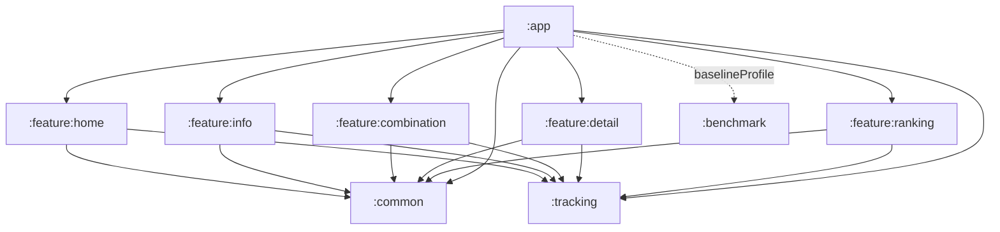

# Runewords

Diablo 2 룬과 룬워드 정보를 보여주는 Android 앱입니다.

[Google Play에서 받기](https://play.google.com/store/apps/details?id=com.beok.runewords)

## 기능
- **룬 목록**: 홈 화면에서 모든 룬을 보여줍니다.
- **룬 정보**: 룬을 무기, 방어구, 투구, 방패에 넣었을 때의 효과를 보여줍니다.
- **룬워드 조합**: 룬을 선택하면 그 룬이 들어가는 룬워드 목록을 보여줍니다.
- **룬워드 상세**: 룬워드의 필요 룬, 장착 가능 아이템, 옵션을 보여줍니다. 스탠다드/래더 전용 여부도 표시합니다.
- **랭킹**: 최근 기간 동안 많이 조회된 룬과 룬워드를 보여줍니다.
- **App Links**: 링크로 룬워드 조합 화면과 룬워드 상세 화면을 바로 엽니다.

## 모듈 구조

| 모듈 | 역할 |
|------|------|
| `:app` | 진입점, Navigation, 광고, 인앱 업데이트/리뷰, App Check |
| `:feature:home` | 룬 목록 화면 |
| `:feature:info` | 룬 정보 화면 |
| `:feature:combination` | 룬별 룬워드 목록 화면 |
| `:feature:detail` | 룬워드 상세 화면 |
| `:feature:ranking` | 룬/룬워드 랭킹 화면 |
| `:common` | 공통 모델, 리소스, 테스트 픽스처 |
| `:tracking` | Firebase Analytics 이벤트 추적 |
| `:benchmark` | Baseline Profile 생성, 시작 성능 측정 |
| `:coding-convention` | Konsist로 네이밍과 ViewModel 규칙 검사 |
| `build-logic` | Gradle 컨벤션 플러그인 |

## 기술 스택
- **UI**: Jetpack Compose, Material 3, Navigation Compose (type-safe route)
- **아키텍처**: 멀티 모듈, data/domain/presentation 계층
- **DI**: Hilt
- **비동기**: Kotlin Coroutines
- **데이터**: Cloud Firestore, Firebase Remote Config, Room, kotlinx.serialization
- **Firebase**: Analytics, Crashlytics, Performance, App Check (Play Integrity)
- **성능**: Baseline Profile, Macrobenchmark
- **테스트/품질**: JUnit 5, MockK, AssertJ, Konsist, detekt, ktlint, JaCoCo
